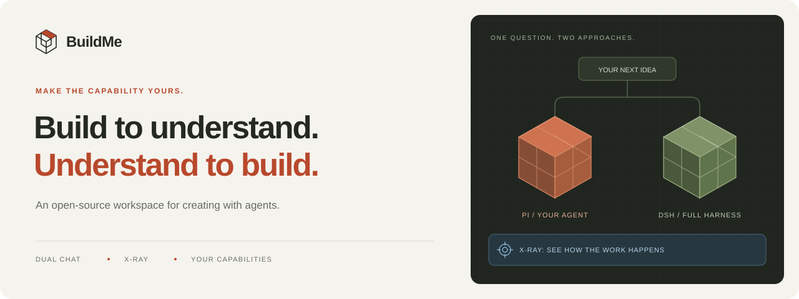

<div align="center">



**把 AI 的能力，变成你的能力。**

一个能完成真实任务，也能让你看见内部过程的开源 Agent 工作台。

**简体中文** · [English](README.en.md)

[项目介绍页](https://jsdnaasd.github.io/buildme-agent/) · [快速开始](#快速开始) · [产品理念](docs/product-brief.md) · [架构](docs/architecture.md) · [参与贡献](CONTRIBUTING.md)


</div>

---

## 为什么做 BuildMe

**我们相信，使用 Agent 的过程，也应该成为掌握 Agent 的过程。**

从一个真实想法出发：改进项目、编写代码、整理资料、制作作品。Agent 帮你推进任务，BuildMe 帮你理解它如何选择工具、组织上下文、调用模型，以及消耗了哪些 Token。

你可以打开一项能力，观察下一轮发生的变化；让两个 Agent 同时面对相同任务，比较它们的路径与产物；把发现带到下一次实践里。

**动手创造 → 看见过程 → 调整能力 → 对照验证 → 分享发现。**

面向创作者、开发者，以及希望通过实践理解 Agent 的学生和老师。学习从自己的任务开始，没有固定考题，也不按答案给人排名。

## 有什么特别

| | 你能做什么 |
|---|---|
| **X 光模式** | 展开真实回合，查看模型调用、工具参数与结果、提示词组成、上下文和子任务。静态说明与按需深入讲解帮助你读懂事件。 |
| **我的 Agent** | 用九项开关配置能力。工具、提示词和运行时使用同一份回合配置；修改在下一轮生效。 |
| **双路连续聊天** | 一个输入框提问，Pi 与 DSH 同时流式回答，分别保留上下文。持续追问、停止、恢复历史，再比较文件变化和执行过程。 |
| **Token 账单** | 查看模型报告的输入、输出与缓存用量，追踪工具输出和重复上下文。部分数据、估算和未提供数据分别标明。 |
| **对照实验** | 比较两种引擎、两条模型连接，或“直接读取 / 先搜索再读取”策略。两侧从相同工作区基线建立独立副本。 |
| **探索足迹** | 30 项本地确定性成就与发现卡，由真实事件触发。导出学习记录不包含聊天正文、工具参数或 Trace 内容。 |
| **社区与作品墙** | 独立开源社区，包含帖子、讨论、作品、搜索、审核及对比/成就分享。可自行部署并连接桌面端。 |

### 两个引擎，一个工作台

| | Pi · 你的 Agent | DSH · 完全体 |
|---|---|---|
| 执行内核 | Pi Agent Core | DeepSeek Harness 原生 Agent loop |
| 主要用途 | 调整能力、观察机制、做受控实验 | 体验完整 harness 的执行方式 |
| 扩展方式 | Cordis 插件、提示词、Skill 与能力注册表 | 官方 DSH 插件与 BuildMe bridge |
| 共用体验 | 聊天、工作区、模型连接、X 光、账单 | 聊天、工作区、模型连接、X 光、账单 |

九项可开关能力：**读文档、搜索工作区、读网页、任务清单、计划、Skill、上下文压缩、子 Agent、工作流**。基础读写、编辑、命令和工作区信息始终保留；工作流依赖子 Agent，子任务不会无限继续委派。

模型由你选择：DeepSeek、其他受支持的提供商、兼容接口或本地模型服务。可用模型、工具能力和推理内容取决于所选服务。BuildMe 只展示模型实际返回的思考内容。

## 先体验这条路径

1. **带来一个项目。** 选择本地工作区，配置模型连接，提出真实任务。
2. **展开一次回答。** 点击 X 光或 Token 账单，看模型调用了什么、读入了什么。
3. **改变一个条件。** 打开 Skill、子 Agent 或压缩，观察下一轮的变化。
4. **同时问两路。** 连续追问，对照回答、工具轨迹和文件 diff，再决定采用哪些改动。

## 快速开始

需要 **Node.js 22.19+** 和 **pnpm**。若同时运行社区，使用 Node.js 22.x。

```bash
git clone https://github.com/jsdnaasd/buildme-agent.git
cd buildme-agent
pnpm install
pnpm desktop
```

在「模型与偏好」添加自己的 API Key、模型和连接地址，然后选择工作区。API 费用由所选服务商收取，仓库不提供共享密钥。

<details>
<summary><strong>CLI 与桌面打包</strong></summary>

```bash
pnpm build
node dist/cli.js init
node dist/cli.js plugins doctor
# 先在本机配置所选提供商要求的环境变量
node dist/cli.js run "查看当前工作区，说明项目结构"

# macOS 默认目标为 arm64
pnpm desktop:package
# Windows x64 打包目标；不代表已完成 Windows 实机验收
pnpm desktop:package:win
```

详细配置见 [运行指南](docs/runtime-guide.md)。

</details>

<details>
<summary><strong>自托管社区</strong></summary>

社区独立安装，要求 Node.js 22.19–22.x。从仓库根目录进入：

```bash
cd community
pnpm install
cp .env.example .env
# 按 community/README.md 生成并填写本机 SESSION_SECRET
pnpm build
pnpm dev
```

社区使用 Hono、SQLite 和本地文件/OSS 存储。账号、GitHub OAuth、域名与生产部署需自行配置；源码公开不代表已有可用的公共社区服务。见 [社区说明](community/README.md) 与 [部署指南](community/deploy/README.md)。

</details>

## 数据与执行边界

- **数据默认保存在本机。** 使用远程模型时，任务需要的内容会发送给你选择的服务商；本地工作台不意味着所有推理离线完成。
- **双路默认免工具审批。** 两侧在独立副本中工作；强制只读与命令隔离仍由执行层约束。采用到原文件前展示变更并检查冲突。
- **比较实际表现。** 同模型下可以比较两种 harness，但随机输出差异不能全部归因于 harness。
- **记录忠于实际采集。** 缺失用量不补零，部分统计不冒充完整总量，模型提供的推理与最终回答分开显示。
- **额外调用由你触发。** 查看本地 Trace 和成就不调用模型；深入讲解、差异总结与再次对比会使用你选定的模型连接。

## 源码地图

| 目录 | 内容 |
|---|---|
| [`desktop/`](desktop/) | Electron 主进程、IPC、聊天和可视化界面 |
| [`src/core/`](src/core/) | Pi 运行时、Trace、能力、成就、对比和工作区 |
| [`src/full/`](src/full/) | DSH bridge、事件采集与工具接入 |
| [`src/plugins/`](src/plugins/) · [`bundles/`](bundles/) | Cordis 插件、系统提示词与能力提示词 |
| [`community/`](community/) | 完整社区服务、前端、数据迁移、测试与部署工具 |
| [`test/`](test/) · [`scripts/`](scripts/) | 单元测试、隔离 Electron 验收和打包 |
| [`docs/`](docs/) | 产品、架构、需求、实现与验收记录 |

## 当前状态与贡献

BuildMe 正在持续开发。macOS arm64 有实际桌面验收记录；Windows 有打包目标，Windows / Linux 的桌面实机验证仍待完成。DSH 子任务跨 worker 的部分统计存在采集边界，详见 [保真度记录](docs/xray-dsh-fidelity.md)。

欢迎提交问题、复现步骤、交互改进、插件或文档。先阅读 [贡献指南](CONTRIBUTING.md)。[功能构想](docs/feature-ideas.md) 单独记录未来设想，不代表当前已交付。

```bash
pnpm test
pnpm typecheck
pnpm test:typecheck
pnpm lint
pnpm build
```

## 开源与致谢

**桌面端、CLI、Agent 运行时、插件、提示词、社区服务、测试与项目文档均在本仓库公开，BuildMe 自有代码采用 [MIT](LICENSE) 许可证。** 本机密钥、用户聊天、数据库、依赖安装目录和私有部署配置不属于源码发布内容。

感谢 [Pi](https://github.com/earendil-works/pi)、[DeepSeek Harness](https://github.com/deepseek-ai/deepseek-harness) 及依赖生态。BuildMe 是独立项目，保留上游版权与许可，详见 [第三方声明](THIRD_PARTY_NOTICES.md)。

<div align="center">

**Build to understand. Understand to build.**

</div>
